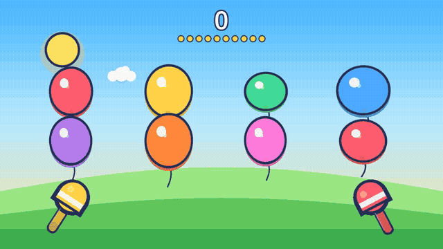
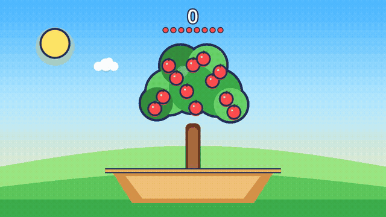
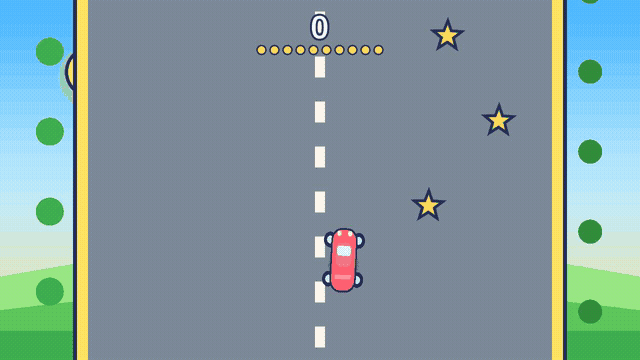

# Wiggle Party setup and verification runbook

This is a step-by-step runbook for an agent with a shell on a Mac. Follow the sections in order. Each section has the exact command, the output that means it worked, and what to do when it does not.

Wiggle Party is a Godot 4.7 project with three short motion games for a parent and a five-year-old. Everyone shares one score. A round always ends on a celebration screen. Art and sound are generated in GDScript.

| Game | Scene | Round | Celebration title |
| --- | --- | --- | --- |
| Balloon Bop | `res://scenes/balloon_bop.tscn` | 75 seconds | Yay! |
| Shake the Tree | `res://scenes/shake_tree.tscn` | 24 seconds | Apples! |
| Wobbly Wheel | `res://scenes/wobbly_wheel.tscn` | 45 seconds | Stars! |

The menu scene is `res://scenes/main_menu.tscn`. Player 0 is the parent (coral, right bat). Player 1 is the child (gold, left bat).

Recorded clips, already in the repo:







Still frames next to those GIFs: `docs/media/menu.png`, `docs/media/balloon_bop.png`, `docs/media/shake_tree.png`, `docs/media/wobbly_wheel.png`. Matching MP4 files use the same basenames.

## 1. Prerequisites and clone

### What the Mac needs

These are already on a stock macOS install:

- `git`
- `curl`
- `unzip`
- `xattr`
- `shasum`
- `system_profiler`

Check them:

```bash
git --version
curl --version | head -n 1
unzip -v | head -n 1
xattr -h >/dev/null && echo "xattr ok"
shasum -a 256 /dev/null
system_profiler SPBluetoothDataType >/dev/null && echo "bluetooth profiler ok"
sw_vers
```

Expected: each command prints a version or `ok`, and `sw_vers` shows `ProductName: macOS`. `shasum -a 256 /dev/null` prints `e3b0c44298fc1c149afbf4c8996fb92427ae41e4649b934ca495991b7852b855  /dev/null`.

If a command is missing, stop. Xcode Command Line Tools supply `git`:

```bash
xcode-select --install
```

That opens a GUI dialog. Wait until `git --version` works, then continue. Homebrew is optional and is only used in the alternate install in section 2.

### Clone

The private Origin repo is `acelera-fab-o/joycon-family-games`. Run `origin auth login` once before cloning so Git's credential helper authenticates HTTPS and the clone URL stays free of tokens.

```bash
cd ~
git clone https://origin.cursor.com/acelera-fab-o/joycon-family-games.git && cd joycon-family-games
pwd
test -f project.godot && echo "CLONE OK"
rg '^config/name=' project.godot
```

Expected:

- `git clone` prints `Cloning into 'joycon-family-games'...` and exits 0.
- `pwd` ends in `/joycon-family-games`.
- The test prints `CLONE OK`.
- `rg` prints `config/name="Wiggle Party"`.

`rg` is optional. If it is missing, use:

```bash
grep '^config/name=' project.godot
```

If it fails:

| What you see | What to do |
| --- | --- |
| `Authentication failed`, `could not read Username`, or `repository not found` | This repo is private. Run `origin auth login` with an account that can read `acelera-fab-o/joycon-family-games`, then clone again. Do not put a token in the URL. |
| Clone exits 0, then `CLONE OK` is missing | You are in the wrong directory. `cd joycon-family-games` from the directory where `git clone` ran (`~` if you used the command above). |
| `config/name` is something else | This is a different project. Stop and clone the Wiggle Party URL. |

Stay in this directory for every later command. `.godot/` appears after section 3 and is gitignored. Do not commit it.

## 2. Install Godot 4.7.2 stable

Install the official standard build (GDScript). Do not install the .NET build. The project does not use C#.

The download page is [Godot 4.7.2 stable](https://godotengine.org/download/archive/4.7.2-stable/). The macOS universal zip linked from that page is:

```text
https://downloads.godotengine.org/?version=4.7.2&flavor=stable&slug=macos.universal.zip
```

That URL is the one the archive page uses for "macOS - Universal" (Apple Silicon and Intel). It redirects to the file `Godot_v4.7.2-stable_macos.universal.zip`. The same file is also published as a GitHub release asset. SHA-256 of that zip:

```text
c58a24e31d720be9d62f60cb5627c4e695fb72f21b0cfe1bc9ccaa9a3b3ba63e
```

### Download, install, clear quarantine

```bash
mkdir -p "$HOME/src"
cd "$HOME/src"
curl -fL --retry 3 --retry-delay 2 \
  -o Godot_v4.7.2-stable_macos.universal.zip \
  "https://downloads.godotengine.org/?version=4.7.2&flavor=stable&slug=macos.universal.zip"
shasum -a 256 Godot_v4.7.2-stable_macos.universal.zip
rm -rf "$HOME/src/godot-macos"
unzip -q Godot_v4.7.2-stable_macos.universal.zip -d "$HOME/src/godot-macos"
ls "$HOME/src/godot-macos"
rm -rf /Applications/Godot.app
mv "$HOME/src/godot-macos/Godot.app" /Applications/Godot.app
xattr -dr com.apple.quarantine /Applications/Godot.app
/Applications/Godot.app/Contents/MacOS/Godot --version
```

Then return to the clone:

```bash
cd ~/joycon-family-games
```

Expected:

- `curl` exits 0 and the zip is about 163 MB (`ls -lh` shows a size near `163M`).
- `shasum` prints `c58a24e31d720be9d62f60cb5627c4e695fb72f21b0cfe1bc9ccaa9a3b3ba63e  Godot_v4.7.2-stable_macos.universal.zip`.
- `ls` of the unzip directory prints `Godot.app`.
- `--version` prints exactly:

```text
4.7.2.stable.official.ed1daf0bf
```

The binary may also print a Vulkan or Metal warning on the next lines. The version line is the check. Exit code of `--version` is 0.

If it fails:

| What you see | What to do |
| --- | --- |
| `curl: (22)` or a non-200 | Retry the `curl` once. If it still fails, download the same filename from the GitHub release asset: `https://github.com/godotengine/godot/releases/download/4.7.2-stable/Godot_v4.7.2-stable_macos.universal.zip`. The SHA-256 above is the hash of that asset. |
| SHA-256 differs | Delete the zip and use the GitHub URL in the row above. Do not install a zip whose hash does not match. |
| `unzip` does not produce `Godot.app` | `find "$HOME/src/godot-macos" -name 'Godot.app' -maxdepth 3`. `mv` that path to `/Applications/Godot.app`. |
| `mv: /Applications/Godot.app: Permission denied` | `/Applications` is not writable. Use `sudo mv "$HOME/src/godot-macos/Godot.app" /Applications/Godot.app`, then run `xattr` with `sudo` as well. |
| macOS says the app is damaged, or "Apple could not verify" | Run the `xattr -dr com.apple.quarantine` command again. Then open once with `open /Applications/Godot.app`. If a dialog appears, choose Open. |
| `--version` is missing, or the string is not `4.7.2.stable.official.ed1daf0bf` | You installed a different build. Remove `/Applications/Godot.app` and repeat this section. A 4.6 binary will load scenes and will fail the smoke test, because the joypad motion methods are part of 4.7. |

### Homebrew alternative

Use this only when Homebrew is already installed and you accept that the cask tracks current stable. As of this runbook the cask is 4.7.2 and installs the same universal zip.

```bash
brew install --cask godot
/Applications/Godot.app/Contents/MacOS/Godot --version
command -v godot
godot --version
```

Expected: both version commands print `4.7.2.stable.official.ed1daf0bf`. `command -v godot` prints a Homebrew path. Homebrew also puts `Godot.app` in `/Applications` and symlinks `godot` onto the PATH.

If `brew` is missing, or the version string is anything else, ignore Homebrew and use the zip steps above. The rest of this runbook calls `/Applications/Godot.app/Contents/MacOS/Godot` so either install works.

## 3. Open the project and confirm it loads

Run this from the clone.

### Headless import

```bash
/Applications/Godot.app/Contents/MacOS/Godot --headless --path . --import \
  > /tmp/wiggle-import.log 2>&1
echo "IMPORT EXIT:$?"
perl -pe 's/\e\[[0-9;]*m//g' /tmp/wiggle-import.log > /tmp/wiggle-import.plain
head -n 5 /tmp/wiggle-import.plain
grep -n "ERROR\|SCRIPT ERROR\|Failed to load" /tmp/wiggle-import.plain || echo "IMPORT CLEAN"
grep -n "DONE" /tmp/wiggle-import.plain | head -n 20
test -d .godot && echo "GODOT DIR OK"
```

Expected:

- `IMPORT EXIT:0`
- The first line of the plain log is:

```text
Godot Engine v4.7.2.stable.official.ed1daf0bf - https://godotengine.org
```

- `IMPORT CLEAN`
- At least one `[ DONE ]` line. A first import includes `[ DONE ] first_scan_filesystem`, `[ DONE ] update_scripts_classes`, and `[ DONE ] reimport`. Godot also prints progress percentages. Those are normal.
- `GODOT DIR OK`

`.godot/` is a local cache. Leave it untracked.

If it fails:

| What you see | What to do |
| --- | --- |
| `IMPORT EXIT` is not 0 | Read `/tmp/wiggle-import.plain` from the first `ERROR` or `SCRIPT ERROR`. A missing `project.godot` means the shell is not in the clone. `cd` there and run the import again. |
| `SCRIPT ERROR` in a `.gd` file | The Godot binary is older than 4.7, or the clone is incomplete. Re-check `--version`, then `git status` inside the clone. Do not continue to the editor until import is clean. |
| `Failed to load` on `icon.svg` or a PNG under `docs/media` | Run the import a second time. Godot writes `.import` files on the first pass. A second run that still prints `Failed to load` is a real failure. Stop and report that line. |
| No `Godot Engine v4.7.2` line | The binary on that path is the wrong app. Repeat section 2. |

### Launch the editor

The editor keeps running. Start it in the background and read its log.

```bash
/Applications/Godot.app/Contents/MacOS/Godot --editor --path . \
  > /tmp/wiggle-editor.log 2>&1 &
echo $! > /tmp/wiggle-editor.pid
sleep 8
perl -pe 's/\e\[[0-9;]*m//g' /tmp/wiggle-editor.log > /tmp/wiggle-editor.plain
head -n 15 /tmp/wiggle-editor.plain
ps -p "$(cat /tmp/wiggle-editor.pid)" -o pid,stat,command
grep -n "ERROR\|SCRIPT ERROR" /tmp/wiggle-editor.plain || echo "EDITOR CLEAN"
```

Expected:

- The log starts with `Godot Engine v4.7.2.stable.official.ed1daf0bf - https://godotengine.org`.
- `ps` shows that pid still alive (`stat` begins with `S` or `R`).
- `EDITOR CLEAN`.
- A project window titled around "Wiggle Party" is open on the desktop. The FileSystem dock lists `scenes`, `scripts`, `tests`, and `docs`.

Leave the editor open while you do section 4 if you want the window. Stop it before the smoke test so two Godot processes are not importing at once:

```bash
kill "$(cat /tmp/wiggle-editor.pid)"
sleep 1
ps -p "$(cat /tmp/wiggle-editor.pid)" >/dev/null && echo "STILL RUNNING" || echo "EDITOR STOPPED"
```

Expected: `EDITOR STOPPED`.

If it fails:

| What you see | What to do |
| --- | --- |
| `Unable to initialize display` or the process exits immediately | This Mac session has no window server. Headless import and the smoke test in section 5 are still valid. Playing in section 6 needs a logged-in GUI. Re-run the editor command from Terminal.app inside that GUI session. |
| `EDITOR CLEAN` is missing | Read the plain log. Fix import errors before launching the game. |
| The process is alive and the log is only the version line | Wait another 10 seconds and read the log again. Editor startup on a first open reimports assets. |

`open -a /Applications/Godot.app --args --editor --path "$(pwd)"` also opens the editor and returns at once. Use the direct binary above when you need the log.

## 4. Pair controllers over Bluetooth

You can skip this section and still finish sections 5 and 6 with the keyboard. Come back here when a Joy-Con or a DualShock 4 is on hand.

Gyro is best-effort. Buttons and sticks are the path that works on a Mac. Apple's Game Controller path reports buttons and sticks for these pads and does not report the Joy-Con IMU, so `sensors=false` in the pad listing below is a normal Mac result. The games keep working from the stick and the face buttons. Godot 4.7.2 can read joypad gyro only when `Input.has_joy_motion_sensors(device)` is true. Hold the C key for about a second with the pad still if you want the official calibration routine. Play does not wait for calibration.

### Joy-Con

1. Wake the Mac Bluetooth radio. System Settings → Bluetooth, turn Bluetooth on.
2. On the Joy-Con, hold the small round sync button on the rail (the plastic edge that slides into a Switch, between SL and SR) until the player LEDs run in a chase.
3. In System Settings → Bluetooth, click the Joy-Con when it appears. Pair the left and the right as two devices.
4. Confirm from the shell:

```bash
system_profiler SPBluetoothDataType > /tmp/wiggle-bt.txt
grep -n -A 6 -E "Joy-Con|Connected:" /tmp/wiggle-bt.txt
```

Expected: a `Joy-Con (L)` and/or `Joy-Con (R)` entry under `Connected:`, with `Connected: Yes` on the following lines. The address line is a MAC address. The exact minor keys vary by macOS version.

### PS4 DualShock 4

1. System Settings → Bluetooth, Bluetooth on.
2. Hold the Share button and the PS button together until the light bar double-flashes.
3. Click "Wireless Controller" or "DualShock 4" in the Bluetooth list.
4. Confirm:

```bash
system_profiler SPBluetoothDataType > /tmp/wiggle-bt.txt
grep -n -A 8 -E "Wireless Controller|DualShock|Connected:" /tmp/wiggle-bt.txt
```

Expected: the controller is under `Connected:` and a nearby line says `Connected: Yes`.

If either pad never shows up: charge it, toggle Bluetooth off and on, forget the old entry (click the info button next to the device, then Forget), and repeat the button combo. Move the pad within a meter of the Mac. A Joy-Con that is already paired to a Switch will not show up until you hold sync again.

### Two players, and the combine flag

Godot numbers pads in discovery order.

- `Input.get_connected_joypads()[0]` is player 0, the parent.
- `Input.get_connected_joypads()[1]` is player 1, the child.
- A third pad is ignored.

Connect the parent's pad first, then the child's, if you care which body is which color. The order can change after a reboot. Run the pad script again after you reconnect.

A Mac or SDL sometimes merges two Joy-Cons into one gamepad. This project needs them separate. Set the variable on the Godot process itself, before it starts. Setting it from inside a script is too late.

```bash
export SDL_JOYSTICK_HIDAPI_COMBINE_JOY_CONS=0
```

Keep that export in the shell you use for the pad script and for section 6. `0` leaves the Joy-Cons as two devices.

### Confirm Godot sees each pad

`tests/pads.tscn` prints `Input.get_connected_joypads()`, the name, the GUID, and whether motion sensors are reported. It always exits 0. Run it with a window so the joypad driver starts. Quit the editor first.

```bash
export SDL_JOYSTICK_HIDAPI_COMBINE_JOY_CONS=0
/Applications/Godot.app/Contents/MacOS/Godot \
  --path . --audio-driver Dummy res://tests/pads.tscn \
  > /tmp/wiggle-pads.log 2>&1
echo "PADS EXIT:$?"
perl -pe 's/\e\[[0-9;]*m//g' /tmp/wiggle-pads.log | grep "^PAD "
```

Expected with nothing paired:

```text
PAD COUNT 0
PAD NONE
```

`PADS EXIT:0`. That is a successful run of the script. It is not evidence that a pad is connected.

Expected with one Joy-Con or one DualShock 4, one line after the count, for example:

```text
PAD COUNT 1
PAD 0 device=0 role=player0-parent sensors=false name=Joy-Con (R) guid=<32 hex chars>
```

A DualShock 4 name is often `Wireless Controller` or `DualShock 4`. `sensors=false` on a Mac is the expected best-effort result. `sensors=true` means this Godot process can read gyro and accelerometer for that device. Play still works either way.

Expected with two pads: `PAD COUNT 2`, then `role=player0-parent` and `role=player1-child`.

If it fails:

| What you see | What to do |
| --- | --- |
| `PADS EXIT` is not 0, or `grep` prints nothing | Read `/tmp/wiggle-pads.log` for `SCRIPT ERROR`. Re-run section 3's import, then this command. |
| Bluetooth shows the pad and Godot prints `PAD COUNT 0` | Run the same command without `--audio-driver` changes, from a GUI login. Headless (`--headless`) often cannot see Bluetooth pads. The command above is windowed on purpose. Also confirm `SDL_JOYSTICK_HIDAPI_COMBINE_JOY_CONS=0` is exported in this shell. |
| `PAD COUNT 1` while two Joy-Cons are connected | They were merged. Quit Godot, export `SDL_JOYSTICK_HIDAPI_COMBINE_JOY_CONS=0`, pair them again as two Bluetooth devices, and rerun the script. |
| `sensors=false` | Continue. Use stick, buttons, and the keyboard tables in section 6. Gyro on a Mac Joy-Con is best-effort with Godot 4.7.2 (SDL 3.2.28). |

## 5. Run the automated smoke test

Stop the editor and any game window first (`kill` the pid from section 3). From the clone:

```bash
/Applications/Godot.app/Contents/MacOS/Godot \
  --headless --path . --audio-driver Dummy res://tests/smoke_test.tscn \
  > /tmp/wiggle-smoke.log 2>&1
echo "SMOKE EXIT:$?"
perl -pe 's/\e\[[0-9;]*m//g' /tmp/wiggle-smoke.log > /tmp/wiggle-smoke.plain
grep -n "SMOKE \|FAIL \|MotionInput ready" /tmp/wiggle-smoke.plain
```

Expected: `SMOKE EXIT:0`, and the log contains this line:

```text
SMOKE PASS
```

The same log contains `MotionInput ready` with `"godot":"4.7.2-stable"` and `"joy_motion_api":true`. These `ok` lines are the checks, in order:

```text
  ok   Godot is 4.7 or newer
  ok   Input.get_joy_gyroscope exists
  ok   Input.get_joy_accelerometer exists
  ok   Input.get_joy_gravity exists
  ok   Input.has_joy_motion_sensors exists
  ok   Input.set_joy_motion_sensors_enabled exists
  ok   Input.start_joy_motion_sensors_calibration exists
  ok   Input.is_joy_motion_sensors_calibrated exists
  ok   gyro spike emits a swing
  ok   fast mouse flick emits a swing
  ok   mouse waggle emits a shake
  ok   stick flick emits a swing
  ok   stick sets tilt
  ok   stick waggle emits a shake for player 2
  ok   gravity rolls into tilt
  ok   button is a swing and a point tap
  ok   parsed mouse motion reaches MotionInput
  ok   menu has balloon card
  ok   menu has tree card
  ok   menu has wheel card
  ok   balloon script loaded
  ok   balloon round starts full of balloons
  ok   a swing pops a balloon and scores
  ok   the second player can score too
  ok   tree script loaded
  ok   a shake knocks apples loose
  ok   apples land in the basket
  ok   tilt steers the car to the right
```

A line about leaked `ObjectDB` instances can appear after `SMOKE PASS` as the process exits. With exit code 0 and `SMOKE PASS`, that leak line is leftover audio shutdown noise. Treat the run as passed.

If it fails:

| What you see | What to do |
| --- | --- |
| `SMOKE EXIT:1` and a line `SMOKE FAIL N` | The following lines that start with ` - ` name the failed checks. Also grep `FAIL ` in the plain log. Fix the named check before continuing. Do not treat a nonzero exit as success. |
| `FAIL  Godot is 4.7 or newer` | Section 2 installed the wrong binary. `--version` must be `4.7.2.stable.official.ed1daf0bf`. |
| `FAIL  Input.* exists` | Same cause. The 4.7 joypad motion methods are missing. |
| `SCRIPT ERROR` and no `SMOKE PASS` | A script failed to parse, so the test quit early. Read the script path in the log. Re-run section 3. If import was clean and the smoke test still errors, the working tree has a local edit. `git status` and `git diff`. |
| `SMOKE EXIT:137` or the command is killed | Memory pressure. Close the editor and other Godot processes and run the command again. |
| The command hangs with no `SMOKE` line | You omitted `--headless` and a window is waiting. Ctrl-C, then rerun the exact command above. The test takes a few seconds because the tree scene waits 1.4 seconds for an apple to land. |

## 6. Launch and play each game

Quit any leftover Godot process. Export the Joy-Con flag even when you are on the keyboard, so a later pad connection stays split:

```bash
export SDL_JOYSTICK_HIDAPI_COMBINE_JOY_CONS=0
```

### Launch the menu

```bash
/Applications/Godot.app/Contents/MacOS/Godot --path . \
  > /tmp/wiggle-game.log 2>&1 &
echo $! > /tmp/wiggle-game.pid
sleep 4
perl -pe 's/\e\[[0-9;]*m//g' /tmp/wiggle-game.log | head -n 20
ps -p "$(cat /tmp/wiggle-game.pid)" -o pid,stat,command
```

Expected:

- Log line `Godot Engine v4.7.2.stable.official.ed1daf0bf - https://godotengine.org`.
- A `MotionInput ready` line with `"demo":false`.
- `ps` shows the pid still running.
- The window is the menu: title "Wiggle Party", subtitle "Pick a picture", three cards labeled Bop, Shake, and Drive.

Menu controls, once the window is focused:

| Key or pad | Result |
| --- | --- |
| Left / Right arrows, A / D, or the left stick | Move between the three cards |
| Enter, Space, or the pad's south button (Godot `ui_accept`, DualShock 4 Cross) | Start the highlighted card |
| 1 | Balloon Bop |
| 2 | Shake the Tree |
| 3 | Wobbly Wheel |
| Mouse click on a card | Start that game |

Click the game window first. macOS delivers keys to the focused window.

To stop the game later:

```bash
kill "$(cat /tmp/wiggle-game.pid)"
```

### Direct launch, one scene at a time

Use these when you want to skip the menu. Each command replaces a running game. Kill the previous pid first.

```bash
export SDL_JOYSTICK_HIDAPI_COMBINE_JOY_CONS=0
/Applications/Godot.app/Contents/MacOS/Godot --path . res://scenes/balloon_bop.tscn
```

```bash
/Applications/Godot.app/Contents/MacOS/Godot --path . res://scenes/shake_tree.tscn
```

```bash
/Applications/Godot.app/Contents/MacOS/Godot --path . res://scenes/wobbly_wheel.tscn
```

Add `> /tmp/wiggle-game.log 2>&1 &` and record `$!` the same way as the menu launch if you need the shell back. Expected log is the same version banner plus `MotionInput ready`.

### Self-playing check

`JOY_PARTY_DEMO=1` injects swings, shakes, and steering so the round plays with no hands on the controls. Use it to confirm a scene actually runs.

```bash
export SDL_JOYSTICK_HIDAPI_COMBINE_JOY_CONS=0
JOY_PARTY_DEMO=1 /Applications/Godot.app/Contents/MacOS/Godot \
  --path . res://scenes/balloon_bop.tscn \
  > /tmp/wiggle-demo-balloon.log 2>&1 &
echo $! > /tmp/wiggle-demo.pid
sleep 3
perl -pe 's/\e\[[0-9;]*m//g' /tmp/wiggle-demo-balloon.log | grep "MotionInput ready"
```

Expected: the JSON contains `"demo":true`, the pid is alive, and the window shows balloons popping on their own. Repeat with `res://scenes/shake_tree.tscn` and `res://scenes/wobbly_wheel.tscn`, killing the previous pid between runs. The GIFs at the top of this file are that demo mode.

Keyboard and mouse for player 0 are disabled while a joypad is connected, unless you also set `JOY_PARTY_FORCE_MOUSE=1`. That variable makes the mouse drive player 0 anyway. Set it when you are mapping gyro to the mouse with JoyShockMapper on Windows or Linux. JoyShockMapper has no official macOS build.

### Controls

These tables apply inside a round. On the celebration screen, ignore them and use Enter / Escape, documented under each game.

Player 0 is the parent. Player 1 is the child. A Joy-Con and a DualShock 4 both show up as a Godot joypad. The stick and button columns are the same mapping. The PS4 column names the physical buttons.

**Joy-Con or any other standard pad**

| Action | Player 0 and player 1, each on their own pad |
| --- | --- |
| Swing | Flick the left stick, or press a face button, shoulder, stick click, d-pad direction, or pull a trigger past halfway |
| Shake | Waggle the left stick left and right three times |
| Tilt | Hold the left stick. Gravity tilt is used when sensors report gravity. |
| Point | Left stick, or the right stick when it is away from center |
| Tap | Same buttons as swing |

**DualShock 4**

| Action | Physical control |
| --- | --- |
| Swing | Flick the left stick. Or press Cross, Circle, Square, Triangle, L1, R1, L3, R3, the D-pad, or L2/R2 past halfway |
| Shake | Waggle the left stick left and right |
| Tilt | Hold the left stick (steering for Wobbly Wheel) |
| Point | Left stick, or right stick |
| Tap | Same face buttons, shoulders, and triggers as swing |
| Celebration replay | Cross (Godot `ui_accept`) |
| Celebration home | Circle (Godot `ui_cancel`) or the B mapping |

**Keyboard and mouse**

Used for a player who has no joypad. With no pads connected, one person can play both sides.

| Action | Player 0, parent | Player 1, child |
| --- | --- | --- |
| Swing | Flick the mouse, Space, or left click | F |
| Shake | Waggle the mouse, or R | T |
| Tilt | Arrow keys | W A S D |
| Tap | Space or left click | G |

Hold C with a pad still to run Godot's gyro calibration. That is optional.

### Balloon Bop

Launch from the menu with `1`, or run `res://scenes/balloon_bop.tscn`.

Round length is 75 seconds. The score is the big number at the top. The row of dots under it is the timer. Swing either bat into a balloon. It pops into rectangular confetti and a cream `+1` pill. Both players add to the same score. Balloons that reach the bottom bounce. There is no fail state.

When the dots run out, the remaining balloons pop without adding to the score, confetti falls, and a card reads **Yay!** plus the score. A mint button (replay) and a gold button (house) sit under the card.

| Key | Result |
| --- | --- |
| Enter | Play Balloon Bop again |
| Escape | Return to the menu |
| Click the mint button | Play again |
| Click the gold house | Return to the menu |

### Shake the Tree

Launch from the menu with `2`, or run `res://scenes/shake_tree.tscn`.

Round length is 24 seconds. Shake to drop two apples, or three if the shake is hard. A swing drops one apple. Apples fall from the canopy into the basket. Misses roll back toward the basket. The score is how many landed.

The celebration card reads **Apples!** plus that count. Enter plays the tree again. Escape returns to the menu. The mint and gold buttons do the same.

### Wobbly Wheel

Launch from the menu with `3`, or run `res://scenes/wobbly_wheel.tscn`.

Round length is 45 seconds. Tilt, or hold a stick or the arrow keys, to steer the red car. Both players' tilts add together. Stars disappear when the car touches them and the score counts the stars. The car stays on the road.

The celebration card reads **Stars!** plus the score. Enter plays again. Escape returns to the menu.

### What you should see

Compare the window with the clips:


If the window shows a sky, a score, and the matching toys, the launch worked. Close the game with the pid file or with Escape from a celebration screen and then closing the window.

If it fails:

| What you see | What to do |
| --- | --- |
| The process exits immediately | Read `/tmp/wiggle-game.log`. Display errors mean there is no GUI session. `SCRIPT ERROR` means section 3 did not finish clean. |
| Keys do nothing | Click the game window. If a joypad is connected, the keyboard for that player is off. Unplug the pad, or launch with `JOY_PARTY_FORCE_MOUSE=1` for player 0. |
| Only one bat or one car responds to two Joy-Cons | Rerun section 4. `PAD COUNT` must be 2, and `SDL_JOYSTICK_HIDAPI_COMBINE_JOY_CONS=0` must be set in the environment of this process. |
| The score never moves on a real pad | Use a stick flick or a face button. A slow tilt steers the car and does not swing the bat. For the tree, waggle the stick or press R / T on the keyboard. |
| Demo mode stays on the menu | `JOY_PARTY_DEMO=1` does not pick a card. Pass the scene path on the command line, as in the self-playing check. |

## Agent verification checklist

Run this after sections 1 through 5. Section 4 is required only when a pad is paired. Check each box only when the expected line is actually in the command output.

1. `test -f project.godot` prints `CLONE OK`, and `config/name="Wiggle Party"`.
2. `/Applications/Godot.app/Contents/MacOS/Godot --version` prints `4.7.2.stable.official.ed1daf0bf`.
3. Headless `--import` exits 0, the log starts with `Godot Engine v4.7.2.stable.official.ed1daf0bf`, and `IMPORT CLEAN`.
4. `--editor --path .` stays running, the log has the same version banner, and `EDITOR CLEAN`. Then the editor is stopped.
5. If a pad was paired: `system_profiler` shows it under `Connected:`, and `tests/pads.tscn` prints `PAD COUNT` matching the number of pads, with `player0-parent` on the first pad.
6. `tests/smoke_test.tscn` prints `SMOKE PASS` and the process exits 0.
7. The menu or a direct scene stays running, `MotionInput ready` is in the log, and keys `1`, `2`, and `3` open Balloon Bop, Shake the Tree, and Wobbly Wheel. Optional: `JOY_PARTY_DEMO=1` on each scene shows the same action as the GIFs in `docs/media`.
8. From a celebration screen, Enter restarts that game and Escape returns to the menu.

## Troubleshooting

| Symptom | Cause | Fix |
| --- | --- | --- |
| `git clone` of `joycon-family-games` asks for a password or returns 401/404 | HTTPS auth is missing for the private Origin repo | `origin auth login`, then clone `https://origin.cursor.com/acelera-fab-o/joycon-family-games.git` again with no token in the URL |
| `project.godot` missing after clone | Shell is not in the clone directory | `cd joycon-family-games` |
| SHA-256 of the zip does not match | Truncated download, or a different file | Delete the zip. Download the GitHub asset URL from section 2 and hash it again |
| "Godot is damaged and can't be opened" | Quarantine attribute from `curl` | `xattr -dr com.apple.quarantine /Applications/Godot.app`, then `open /Applications/Godot.app` and confirm Open |
| `--version` is not `4.7.2.stable.official.ed1daf0bf` | Homebrew moved, or an older app is first on the PATH | Call `/Applications/Godot.app/Contents/MacOS/Godot` directly. Reinstall from the zip if that binary is wrong |
| Import exit is not 0 | Wrong directory, or a script error | `pwd` must contain `project.godot`. Read `/tmp/wiggle-import.plain` |
| `SMOKE FAIL` and exit 1 | A check in section 5 failed | Read the ` - ` lines. A Godot version failure means reinstall 4.7.2 |
| `SMOKE PASS` plus an ObjectDB leak line | Audio stream still held at shutdown | Pass. The exit code is the result that matters |
| Editor or game exits with a display error | No window server in this session | Run the GUI commands from a logged-in Mac desktop. Headless import and the smoke test can stay in this shell |
| Pad is in Bluetooth settings and `PAD COUNT 0` | Godot was headless, or the pad is connected to another host | Use the windowed `tests/pads.tscn` command. Hold the sync combo again |
| Two Joy-Cons appear as one pad | SDL combined them | `export SDL_JOYSTICK_HIDAPI_COMBINE_JOY_CONS=0` and start Godot again from that shell |
| `sensors=false` | macOS is not exposing the IMU to Godot 4.7.2 | Play with sticks and buttons. Gyro is best-effort |
| Keyboard does nothing in a round | A joypad owns that player | Disconnect the pad, or set `JOY_PARTY_FORCE_MOUSE=1` for the parent |
| Celebration ignores Enter | The window is not focused, or the round is still going | Click the window. Wait for Yay!, Apples!, or Stars! |

Shipping the same project on a Nintendo Switch needs Nintendo developer approval, a dev kit, and a console port of Godot. This repo does not do that.
